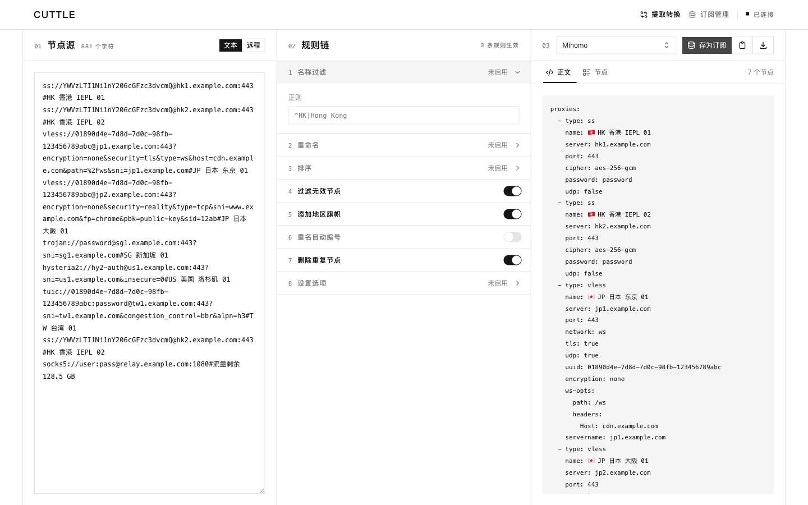

<p align="center">
  
</p>

# Cuttle

Cuttle 将代理节点或订阅内容转换为不同客户端的节点格式，运行在你自己的 Cloudflare Workers 和 D1 上。直接粘贴文本即可转换；连接管理密钥后，可以读取远程来源并保存长期订阅。

[使用指南](#使用指南) · [自托管部署](#自托管部署) · [API](docs/api.md) · [本地开发与测试](docs/development.md)

## 功能概览

### 输入与协议

支持节点 URI、Base64 订阅、SSD、Clash / Mihomo YAML、sing-box JSON、Xray / V2Ray JSON，以及 Surge、Loon、Quantumult X 和 Egern 节点内容。HTML 页面会被报告为无效来源。

sing-box JSON 以 `tls.enabled: true` 表示开启 TLS；省略 `tls` 或 `enabled` 不会自动启用 TLS。

远程来源可以填写多个链接，用换行或 `|` 分隔。各来源分别解析，按填写顺序合并节点，再执行一次完整规则链；多个来源可以使用不同格式。

可处理的协议包括 SS、SSR、VMess、VLESS、Trojan、Hysteria、Hysteria 2、TUIC、AnyTLS、Snell、Mieru、WireGuard、SSH、HTTP(S) 和 SOCKS5。具体协议和传输方式能否输出，取决于目标客户端。

### 规则处理

规则链支持正则筛选、重命名、排序、过滤无效节点、地区旗帜、重名编号、去重，以及设置 UDP、TFO 和跳过证书验证。规则按顺序执行；不配置规则时直接转换。

### 输出客户端

界面提供以下 12 个输出选项：

| 客户端        | `target`       | 输出内容                                     |
| ------------- | -------------- | -------------------------------------------- |
| 通用 URI      | `uri`          | 未编码的节点 URI 列表                        |
| Mihomo        | `mihomo`       | YAML `proxies`                               |
| Clash Classic | `clash`        | YAML `proxies`                               |
| Stash         | `stash`        | YAML `proxies`                               |
| sing-box      | `sing-box`     | JSON `outbounds`，WireGuard 使用 `endpoints` |
| Xray          | `xray`         | JSON `outbounds`                             |
| V2Ray         | `v2ray`        | 整体 Base64 编码的 URI 列表                  |
| Surge         | `surge`        | 节点行                                       |
| Surfboard     | `surfboard`    | 节点行                                       |
| Egern         | `egern`        | YAML `proxies`                               |
| Loon          | `loon`         | 节点行                                       |
| Quantumult X  | `quantumult-x` | 节点行                                       |

生成内容用于导入节点，不包含完整客户端的路由、规则集或运行设置。无法在目标格式中表示的节点会被跳过，原因显示在诊断信息中。

TLS 和传输方式按协议检查。例如，TLS SOCKS 不会转换为普通 SOCKS URI；不能表达该连接的目标会跳过节点并报告原因。转换只处理配置，不检查节点是否在线或能否连接。

## 使用指南

### 完成一次转换

1. 在“节点源”中粘贴内容。读取远程订阅时，先通过页面顶部的连接按钮输入管理密钥，再选择“远程”。
2. 按需设置规则链。
3. 选择输出客户端并点击“生成”。
4. 在“正文”和“节点”中检查结果。若出现诊断提示，展开查看跳过的内容，再复制或下载正文。

修改来源、规则或客户端后，已有结果会标记为待重新生成。

### 保存和管理长期订阅

连接管理密钥后，生成结果旁会提供“存为订阅”；也可以进入“订阅管理”直接新建。填写名称、来源、默认客户端和规则后保存，并立即复制返回的地址：

```text
https://cuttle.{your-worker}.workers.dev/subscribe/<token>
```

`<token>` 是系统生成的凭据，只在创建或轮换后返回。普通编辑不改变地址；轮换会更换凭据。管理界面会拒绝过期版本的保存，遇到冲突时重新打开编辑器或刷新页面后再编辑。

文本订阅使用保存的内容；远程订阅按访问触发刷新，并复用短期缓存。停用、删除和轮换在源站生效，但不能收回客户端已下载或 HTTP 缓存中的内容。刷新与缓存的具体行为见 [API 缓存说明](docs/api.md#刷新与缓存)。

### 临时切换输出格式

在订阅地址上附加 `?target=`，即可覆盖本次输出格式：

```text
https://cuttle.{your-worker}.workers.dev/subscribe/<token>?target=sing-box
```

可用值见[输出客户端](#输出客户端)。移除参数后恢复订阅的默认目标。

## 自托管部署

按照[部署指南](docs/deployment.md)配置 Cloudflare 凭据和管理密钥，通过仓库内的 GitHub Actions 部署。已有部署升级时，须先应用 D1 迁移，再发布 Worker；Actions 已按这一顺序执行。

需要本地运行、验证修改或更新输出快照时，参见[本地开发与测试](docs/development.md)。程序调用参见 [API](docs/api.md)。

## 安全边界

- 管理 API 和远程读取要求管理密钥；本地文本转换无需密钥。
- 订阅地址持有者可读取对应输出，应像密码一样保管地址。
- 远程读取只接受 HTTP(S)，检查地址和 DNS 结果，并限制重定向、链接数量、体积和请求时间。
- 来源和生成结果以明文存放在 D1；备份与导出也包含这些内容。
- Cuttle 不执行节点中的脚本，也不验证代理服务器能否实际连接。输出快照通过不等于真实客户端导入或连通性验证。
